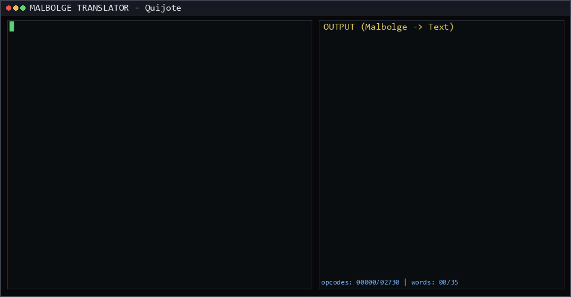

# Malbolge Translator v2.0 — Generador de Programas Malbolge en O(N) y Modo Multiprograma

[](https://github.com/DannyBaanks/Malbolge-Translator)
[](LICENSE)
[](https://www.python.org/downloads/)
[](#testing)

**Genera programas de Malbolge puro que imprimen texto arbitrario exactamente.**



Esta herramienta usa sintesis incremental de estado-maquina con resets periodicos de ancla para hacer la generacion de texto de Malbolge practica para textos arbitrariamente largos.

---

## Como funciona

Malbolge es un lenguaje auto-modificante y counter-machine donde cada instruccion depende del estado completo del maquina. Los enfoques tradicionales intentan generar el programa completo de una vez, lo cual es inviable para textos largos.

Este traductor usa dos estrategias complementarias:

**Modo Multiprograma (publicado, verificado):**
```
UTF-8 → MALRT1 (66 símbolos) → 66 programas .mal independientes
       → stdout concatenado (host) → MALRT1 decode → UTF-8 original
```
Cada símbolo MALRT1 es un programa Malbolge puro ejecutado independientemente y verificado 2×. El host concatena salidas. Ver `evidence/multiprogram/`.

**Modo Capítulos (artifact demo):**
```
Bootstrap (i + o*99) → Palabra 1 → Palabra 2 → ... → Palabra N + halt (v)
```
Cada capítulo de Don Quijote es un **único programa .mal** que se ejecuta de principio a fin en el intérprete clásico, sin intervención del host. Ver `artifacts/quijote/chapter_NNN/`.

No hay "Bridge → Reset a Ancla" en tiempo de ejecución: esa maquinaria (`anchor.py:107-125`, `execute_from_snapshot`) es código muerto/roto y no se usa en la generación publicada.

---

## Novedades 2.0 (Integración Autobolge, BolgeForge y PureEpoch)

1. **Motor de Síntesis Constructiva Autobolge en $O(N)$ (`--engine conveyor`):**
   - Síntesis algebraica instantánea (~2–50 ms) para textos de hasta ~1,000–1,500 caracteres (dentro del hueco estéril de 3,194 celdas, $\Delta c \equiv \Delta d$).
   - Generación del párrafo de apertura de El Quijote en 50 ms (`--quijote-opening`).
   - Fallback automático o manual (`--engine auto|conveyor|beam`).
2. **Puente con el Oráculo Canónico Estricto `mb_ref` (BolgeForge):**
   - Validación estricta y capacidad de streaming para libros completos a través del Streaming Cat (`artifacts/cat_compact.mal`, 7,690 celdas, `--stream-cat`).
3. **Preflight Epistemológico y Análisis de Límites (`--single-program-preflight`):**
   - Análisis formal de viabilidad y perfiles de ejecución:
     * $\le 1,000$ chars $\to$ Autobolge Conveyor (`DEMONSTRATED_CONVEYOR` en un único `.mal` Classic autónomo).
     * $\le 59,049$ celdas $\to$ Búsqueda o ensamblado directo en cinta Classic.
     * Libro completo (~2.2 MB):
       - `SINGLE_PROGRAM_FULL_DON_QUIJOTE = NOT_DEMONSTRATED`: la existencia de un único programa autónomo zero-stdin sigue abierta.
       - `SINGLE_PROGRAM_IMPOSSIBILITY = NOT_DEMONSTRATED`: la compresión empírica conocida (~450 KB) constituye únicamente una cota superior heurística, no una cota inferior demostrada de complejidad de Kolmogórov.
       - Rutas alternativas verificadas (perfiles separados):
         1. **BolgeForge Streaming Cat** (`artifacts/cat_compact.mal`, 7,690 celdas): demostrado como consumidor de flujo continuo (requiere `stdin`).
         2. **MALRT1 Multiprogram** (66 programas puros): demostrado mediante orquestación y concatenación del host externo (**no equivale a un único `.mal`**).
5. **Demostración de Expansión Positiva y Contador Ripple XLAT2 (`--ripple-counter <STAGES>`):**
   - Demostración empírica y formal de que el flujo de salida de Malbolge Classic **NO** está acotado por el techo de memoria de 59,049 celdas.
   - Generación de programas autónomos cero-stdin con cascadas de ciclos `XLAT2` de longitud 5 (`Nop/Nop/Nop/Nop/MovD`) en serie (contador ripple).
   - Emisión demostrada y verificada con el oráculo C estricto de hasta **78,125 bytes** con terminación limpia (`HALT`) desde un archivo de ~5.3 KB (factor de expansión **14.58x**). Ver reporte y evidencia en `experiments/in_language_compaction_v0/`.
6. **Ejecutor Nativo y Python Classic VM:**
   - La suite ejecuta sin dependencias rotas mediante el emulador puro de Malbolge Classic o los binarios compilados de la toolkit.

---

## Instalacion

```bash
# Requiere Python 3.10+
pip install malbolge-generator
pip install -e .
```

O desde fuente:

```bash
git clone https://github.com/DannyBaanks/Malbolge-Translator.git
cd Malbolge-Translator
pip install -e .
```

---

## Inicio Rapido

```bash
# Síntesis constructiva O(N) instantánea (~2-50 ms vía Autobolge 2.0)
malbolge-translate "Cervantes y Malbolge!" --execute

# Apertura de El Quijote sintetizada y verificada en 50 ms
malbolge-translate --quijote-opening

# Preflight de límites y viabilidad física (Autobolge vs Tape 3^10 vs Shannon)
malbolge-translate --single-program-preflight "Texto a evaluar"

# Expansión positiva en el propio lenguaje (78,125 caracteres emitidos desde 5.3 KB con parada limpia HALT, ratio 14.58x)
malbolge-translate --ripple-counter 7

# Streaming Cat de BolgeForge (transportar archivos de cualquier tamaño por stdin en un solo .mal)
malbolge-translate --stream-cat quijote.txt

# Transliteracion (legible, lossy)
malbolge-translate "Hola mundo" --execute
malbolge-translate "你好" --direct --execute

# Roundtrip UTF-8 exacto reversible (byte-exact)
malbolge-translate "你好，世界 😭🔥" --direct --roundtrip --execute
malbolge-translate "Hola, señor. ¿Cómo estás?" --direct --roundtrip --execute

# Transport UTF-8 bounded de dos partes: dos programas independientes, uno por mitad
malbolge-translate "Hi :p" --direct --roundtrip --two-part --output-dir two_part_out

# Traducir archivo
malbolge-translate input.txt --output-dir out --execute
malbolge-translate input.txt --roundtrip --output-dir out --execute

# Con mapeos de lexico custom (solo modo transliteracion)
malbolge-translate "Hola 世界" --lexicon-add 世 shi --lexicon-add 界 jie --execute
```

---

## Generar Don Quijote (Demo Artifact)

```bash
# Descarga desde Project Gutenberg, genera .mal completo
malbolge-quijote --output-dir artifacts/quijote --execute
```

Esto crea:
- 17 capítulos independientes en `artifacts/quijote/chapter_NNN/`
- Cada capítulo: `quijote_chNNN_full.mal`, `.op`, `manifest.json`, `word_XXXX.op`
- Manifest global: `artifacts/quijote/manifest.json`

---

## Modos

### Modo A — Transliteracion (lossy, legible)

```
Unicode input → aproximacion ASCII legible → Malbolge → aproximacion
```

Propiedades: legible = usualmente si, reversible = no, byte exact = no.
Ejemplo: `"你好" → "nihao"`, `"ñ" → "ny"`. Util para display pero no byte-exact.

### Modo B — Roundtrip UTF-8 exacto (reversible, byte-exact)

```
TEXTO UTF-8 ORIGINAL → envoltura ASCII reversible (MALRT1) → programa Malbolge puro
    → ejecucion canonica → payload ASCII → decode → TEXTO UTF-8 ORIGINAL
```

Envoltura: `MALRT1:<base64(utf8_bytes)>:<sha256_hex>`. Deterministica, ASCII-safe, versionada, verificada de integridad.
Propiedades: payload legible = irrelevante, reversible = si, byte exact = si cuando la verificacion pasa.

**Claims:**

```
MALBOLGE_NATIVE_UNICODE        = FALSE
TRANSLITERATION_REVERSIBLE     = FALSE
ROUNDTRIP_BYTE_EXACT           = TRUE solo para runs verificadas que pasan
FRESH_VM_CONTINUATION          = DEMONSTRATED (snapshot serializado + VM fresca, output byte-identico)
ARBITRARY_SIZE_ROUNDTRIP       = DEMONSTRATED (perfil multiprograma, inputs finitos)
FULL_DON_QUIJOTE_UTF8_ROUNDTRIP= DEMONSTRATED (perfil multiprograma por diccionario)
SINGLE_PROGRAM_FULL_DON_QUIJOTE= NOT_DEMONSTRATED
SINGLE_PROGRAM_ARBITRARY_SIZE  = NOT_CLAIMED
```

El modo roundtrip puede preservar texto UTF-8 valido arbitrario byte por byte, sujeto a limites de recursos de sintesis/ejecucion de Malbolge.
No reclames "soporta todos los idiomas" — es transporte de bytes, no cobertura linguistica.

---

### Continuacion en VM fresca

`malbolge_translator.fresh_vm_continuation` demuestra que un programa Malbolge
puede detenerse a mitad de vuelo, serializar su estado de maquina
(tape + `a`/`c`/`d` + `halted`), y terminar en un `MalbolgeInterpreter()`
**nuevo** produciendo output byte-identico. La propiedad verificada es
`prefijo.output + sufijo.output == corrida.completa.output`, apoyandose en
`MalbolgeMachine.copy()` y `execute_from_snapshot()` del toolkit (que
reverse-normaliza el sufijo en la posicion absoluta correcta).

```python
from malbolge import ProgramGenerator
from malbolge_translator import run_fresh_vm_continuation

opcodes = ProgramGenerator().generate_for_string("Hello, World!").opcodes
evidence = run_fresh_vm_continuation(opcodes)
assert evidence.fresh_vm_continuation_pass
```

Evidencia: `evidence/fresh_vm_continuation/evidence.json` (3/3 PASS).

---

### Roundtrip multiprograma de tamano arbitrario

MALRT1 solo usa 66 simbolos (`A-Z`, `a-z`, `0-9`, `+`, `/`, `=` y `:`).
`multiprogram_roundtrip.py` sintetiza un programa Malbolge puro por simbolo,
lo ejecuta dos veces en VMs frescas y sella sus opcodes/programa con SHA-256.
El harness representa cualquier payload finito como referencias a ese
diccionario y concatena exclusivamente el stdout verificado de esos programas.

```
UTF-8 arbitrario → MALRT1 → referencias a 66 programas .mal
                   → stdout concatenado → MALRT1 decode → UTF-8 original
```

Evidencia ejecutada:

- Diccionario completo: `66/66 PASS`.
- Control grande: `1,000,000` bytes UTF-8 → `1,333,408` chars MALRT1 → bytes y SHA-256 identicos.
- Don Quijote completo en espanol, Gutenberg #2000: `2,205,980` bytes → `2,941,380` chars MALRT1 → bytes y SHA-256 identicos.
- SHA-256 del cuerpo recuperado: `7afbd0f1fa8f2397d280d5fc81ce03e2133ffa34e68251793289861121e03a2c`.

```bash
py -m evidence.multiprogram.generate_evidence
py -m evidence.multiprogram.run_full_quijote
```

Alcance preciso: esto demuestra transporte **multiprograma** de inputs finitos
de longitud arbitraria. No afirma que un unico proceso de Malbolge Clasico
contenga memoria ilimitada ni que exista un `.mal` monolitico con todo el libro.

Ver evidencia completa: `evidence/multiprogram/SHA256SUMS.txt`.

### Preflight monolitico

Antes de intentar un unico `.mal`, medir el corpus local sin sintetizar ni
descargar nada:

```bash
py -m malbolge_translator.cli --file quijote.txt --single-program-preflight
```

El recibo incluye SHA-256, bytes UTF-8, tamaño zlib y el techo fijo de 59,049
celdas de Classic Malbolge. Su veredicto es siempre `NOT_DEMONSTRATED`: que un
payload comprimido quepa no demuestra un descompresor Classic autocontenido, un
programa sintetizado ni una ejecución completa.

---

### Roundtrip de Dos Partes

`--two-part` divide UTF-8 valido en un byte-safe boundary y aplica el
roundtrip MALRT1 existente a cada mitad. `independent` (el default) sintetiza y
verifica ambos programas; `verify-first` persiste y re-lee prueba solo para la parte uno,
asi que retorna deliberadamente `PART_1_ROUNDTRIP_ONLY` en vez de un claim de
archivo completo. `--max-part-bytes` defaults a 4096 y rechaza partes mas grandes antes de
escribir artifacts.

Este es un convenio de transporte bounded, no continuacion cross-VM ni
evidencia de que el Don Quijote completo pueda generarse o ejecutarse.

---

## Ejemplos de API

```python
from malbolge_translator import MalbolgeTranslator, encode_roundtrip, decode_roundtrip

# Codec solo (sin Malbolge)
payload = encode_roundtrip("你好，世界 😭🔥")
assert decode_roundtrip(payload) == "你好，世界 😭🔥"

# Transport completo sobre Malbolge
translator = MalbolgeTranslator()
result = translator.translate_roundtrip("你好，世界 😭🔥")
verification = translator.verify_roundtrip(result)
assert verification.roundtrip_pass
```

### API completa

```python
from malbolge_translator import MalbolgeTranslator, Lexicon, encode_roundtrip, decode_roundtrip

# Transliteracion (existente)
translator = MalbolgeTranslator(anchor_interval=50)
result = translator.translate("Hello world")
translator.execute(result)  # verifica output exacto

# Roundtrip (nuevo)
result = translator.translate_roundtrip("你好，世界 😭🔥")
verification = translator.verify_roundtrip(result)
# o
result, verification = translator.translate_and_verify_roundtrip("Hola, señor", max_steps=5_000_000)

# Lexico custom (solo transliteracion)
lex = Lexicon()
lex.add("ñ", "ny")
lex.add("中", "zhong")
translator = MalbolgeTranslator(lexicon=lex)
```

---

## CLI

```bash
# Transliteracion legible
malbolge-translate "你好" --direct --execute

# UTF-8 exacto reversible
malbolge-translate "你好" --direct --roundtrip --execute

# Flujos de trabajo de archivo
malbolge-translate input.txt --output-dir out --execute
malbolge-translate input.txt --roundtrip --output-dir out --execute
```

El output de ejecucion roundtrip distingue capas:

```
Modo: UTF-8 roundtrip
Bytes originales: 18
Chars de payload encoded: 96
Chars de programa Malbolge: 12450
Ejecucion: HALTED
Payload match: TRUE
UTF-8 bytes match: TRUE
SHA256 match: TRUE
ROUNDTRIP: PASS
```

---

## Motor Zig + contrato híbrido (snapshots Python -> ejecución canónica Zig)

`zig/` contiene un motor Classic Malbolge portado a Zig 0.16 con tres binarios:

- `malbolge-zig` — CLI: `run <archivo.mal> <max_steps>` y `generate <texto>`
- `malbolge-pca` — harness PCA sobre el mismo motor
- `malbolge-gen` — generador por congruencia (resuelve targets cortos)

El VM corrige dos bugs del port original: overflow `u16` al decodificar opcode
(`decodeOpcode` widening a `u32`) y la tabla de encriptación canónica (`ENCRYPT_TABLE`).

**Contrato híbrido MBS1**: la búsqueda de programas es cara y vive mejor en
Python (`ProgramGenerator` con snapshots + random fallback); la ejecución
canónica es barata y vive mejor en Zig. `zig/src/snapshot.zig` define el formato
binario `MBS1` para ese intercambio:

```
magic "MBS1"; u32 tape_len; u32 a; u32 c; u32 d; u8 halted;
tape_len * u16 tape cells      (little-endian)
```

- `malbolge_translator.hybrid_snapshot.export_continuation_snapshot(opcodes, path)`
  ejecuta el prefijo en Python, serializa el estado del `MalbolgeMachine` y
  devuelve un manifiesto `{schema, path, sha256, prefix_opcodes, suffix_opcodes, ...}`.
- `malbolge-zig resume <snapshot.mbs> <suffix-opcodes> [max_steps]` valida el
  snapshot acotado, normaliza el sufijo en su posición absoluta y lo ejecuta con
  la semántica Classic, reportando `status` + `steps` + `output`.

```bash
py -c "
from malbolge import ProgramGenerator
from malbolge_translator.hybrid_snapshot import export_continuation_snapshot
r = ProgramGenerator().generate_for_string('ABC')
export_continuation_snapshot(r.opcodes, 'abc.mbs')   # escribe snapshot + imprime manifest
"
malbolge-zig resume abc.mbs '<sufijo del manifest>'
# => status=halted steps=...  output=ABC
```

Paridad fijada por fixtures en `zig/src/testdata/` (`.mbs` + `.suffix`
incrustados con `@embedFile` en los tests de `snapshot.zig`): ABC y Hello
reanudan en Zig y emiten exactamente el texto. Verificado live: `A`, `ABC`,
`Hello`.

```bash
cd zig && zig build test   # engine + generator + snapshot (fixtures MBS1) PASS
cd zig && zig build        # produce zig-out/bin/{malbolge-zig,malbolge-pca,malbolge-gen}.exe
```

---

## Sintesis 100% Zig + caza de loops RLE (2026-09-10)

En paralelo al contrato hibrido, el nucleo Zig gano un pipeline de sintesis
autocontenido (`zig/src/generator.zig`): proponente DFS espejo del meowbolge
Python, con regla de toque exacta (`d <= pos` al colocar, base con toques
`< desde`) que hace al espejo coincidir con la ejecucion real. Cada candidato
solo se acepta si `engine.zig` lo ejecuta con output exacto.

Herramientas (todo ejecuta en el motor Zig, sin oraculos externos):

| Binario | Proposito |
|---|---|
| `malbolge-gen` | Sintetiza texto corto verificado (`generate <texto> [ancho] [out.mal]`) |
| `malbolge-reduce` | Reduccion semantica por borrado de bloques |
| `malbolge-epoch` | Auditor de epochs `(a,c,d + SHA-256 de cinta)` tras cada `OUT` |
| `malbolge-mutate` | Barridos de mutaciones (1 celda, pares, triples, CHASE/MOVD) |
| `malbolge-loop` | Busqueda aleatoria reproducible de repetidores |

Resultados medidos (deterministas, `ReleaseFast`):

```text
AB:   313 celdas, 313 pasos, out=AB               PASS
ABC:  472 celdas, 472 pasos, out=ABC              PASS
Hola: 544 celdas, 544 pasos, out=Hola             PASS
Hello, World!: 1566 celdas, 1566 pasos            PASS
```

Evidencia: `experiments/rle_decompressor_v0/evidence/hello_world_zig.mal`
(SHA-256 `18637B0D…2747C629`), guia operable en
`experiments/rle_decompressor_v0/GUIA.md`.

**Loop RLE real hallado:** `malbolge-loop` (semilla 42, 500k programas)
encontro un repetidor infinito genuino — 120 celdas que ciclan emitiendo
`0x1d` con `repeated_epoch=true` confirmado por dos vias. Mecanismo: un OUT en
celda 13 + un CHASE en 74 que salta atras + MOVDs + sin HALT (punto fijo
`a=29`). Evidencia: `evidence/loop_found.mal` (SHA-256 `D8956833…A2FB7F0`).
La direccion del byte no se logro: 33,480 mutantes buscando repetidores de
`A`, espacio y `e` dieron triple NOT_FOUND.

**Ley de escala (veredicto):** la sintesis por byte cuesta ~120 celdas/byte,
asi que el Quijote (2,205,980 bytes) necesitaria ~265M celdas frente al techo
duro de 59,049 — factor ~4500x. Esa ruta queda refutada cuantitativamente; el
perfil multiprograma publicado arriba no se ve afectado.

```bash
cd zig && zig build test                  # suite Debug (e2e exige ReleaseFast)
zig test -O ReleaseFast src/generator.zig # suite + end-to-end AB
```

Claims de esta seccion:

```
ZIG_SYNTHESIS_SHORT_TEXTS      = DEMONSTRATED (AB/ABC/Hola/HelloWorld verificados en motor)
ZIG_RLE_MECHANISM              = DEMONSTRATED (repetidor infinito 0x1d, epoch confirmado)
ZIG_RLE_STEERING               = NOT_DEMONSTRATED (33k mutantes, triple NOT_FOUND)
SINGLE_PROGRAM_QUIJOTE_VIA_SYNTHESIS = INFEASIBLE (medido ~120 celdas/byte vs 59049)
SINGLE_PROGRAM_FULL_DON_QUIJOTE        = NOT_DEMONSTRATED (sin cambio)
```

---

| Modulo | Proposito |
|--------|---------|
| `conveyor.py` | Síntesis constructiva $O(N)$ (Autobolge 2.0) y emulador Classic puro |
| `oracle.py` | Puente de oráculos (`mb_ref` de BolgeForge, Python Classic VM, Streaming Cat) |
| `single_program.py` | Preflight termodinámico de límites (Shannon vs capacidad $3^{10}$) |
| `translator.py` | Pipeline principal: lexicon → split → sintetizar → chain + `translate_roundtrip` / `verify_roundtrip` |
| `roundtrip.py` | Codec UTF-8 reversible: `MALRT1:<base64>:<sha256>` (sin logica Malbolge) |
| `multiprogram_roundtrip.py` | Diccionario MALRT1 (66 programas puros) y composicion multiprograma |
| `two_part_roundtrip.py` | Flujo de trabajo bounded de dos programas MALRT1 y verificacion persistida |
| `fresh_vm_continuation.py` | Serializacion de estado Malbolge y continuacion en VM fresca |
| `hybrid_snapshot.py` | Exportador del contrato MBS1 (snapshot Python -> ejecucion canonica Zig) |
| `anchor.py` | AnchorManager, WordBank — estados canonicos y cache de continuaciones |
| `lexicon.py` | Mapeos extensibles por usuario (transliteracion/encoding) |
| `cli.py` | Interfaz de linea de comandos (`--roundtrip`, `--show-program`) |

---

## Lexico / Encoding

La herramienta incluye un lexico con 300+ mapeos (transliteracion, lossy):

- Espanol: `áéíóúñ` → `aeiouny`
- Frances: `àâäçèêë` → `aaceee`
- Aleman: `ßäöü` → `ssaeoeue`
- Griego/Cirillico/Chino/Japones/Coreano
- Simbolos, matematicas, flechas, box drawing, emoji

**Modo A (transliteracion)**: aproximacion lossy. `TRANSLITERATION_REVERSIBLE = FALSE`. Los bytes originales no se preservan.

**Modo B (roundtrip)** proporciona preservacion exacta via codec reversible (`roundtrip.py`). No se usa transliteracion ahi; los bytes UTF-8 originales sobreviven exactamente.

```bash
malbolge-translate "text" --lexicon-add 世 shi --lexicon-add 界 jie
```

---

## Garantia de Output Exacto

Cada ejecucion `--execute` realiza:

```
sintetizar → interprete canonico → comparacion exacta → MATCH / MISMATCH
```

El interprete canonico es el interprete estandar de Malbolge (memoria 3^10, crazy-op, auto-encriptacion). Sin extensiones custom.

- **Modo transliteracion**: `MISMATCH` vs original es esperado (aproximacion); `MATCH` vs transliterado se verifica.
- **Modo roundtrip**: `verification.bytes_equal` + `sha_equal` + `payload_match` + `HALTED` deben ser todos `TRUE` para `ROUNDTRIP: PASS`. Ver `evidence/roundtrip/` y `docs/ROUNDTRIP_FORMAT.md`.

Artifacts: `*_manifest.json` incluye `mode`, `codec_version`, `original_sha256`, `payload_sha256`, `malbolge_execution_status`, `payload_match`, `bytes_match` (schema v2 para roundtrip, v1 para transliteracion — versionado, no sobreescrito).

```
MALBOLGE_NATIVE_UNICODE = FALSE
UTF8_REVERSIBLE_TRANSPORT_OVER_MALBOLGE = DEMONSTRATED solo cuando los tests end-to-end pasan
```

---

## Testing

```bash
# Suite completa (44 tests, ~77s con generator)
py -m pytest tests -q

# Solo roundtrip codec (sin generator, <1s)
py -m pytest tests/test_roundtrip.py -q

# Multiprograma (requiere malbolge-generator)
py -m pytest tests/test_multiprogram_roundtrip.py -q

# Continuacion en VM fresca
py -m pytest tests/test_fresh_vm_continuation.py -q

# Verificar evidencia
py -m evidence.multiprogram.generate_evidence
py -m evidence.multiprogram.run_full_quijote
```

---

## Requisitos

- Python 3.10+
- Paquete `malbolge-generator` (provee `ProgramGenerator`, `MalbolgeInterpreter`)

---

## Archivos añadidos al repositorio (2026-10-31)

El commit `d8865dd` versiona 79 archivos que estaban sin control de versiones:

- `experiments/direct_opcode_encoding19_v0/` — codificación directa de opcodes.
- `experiments/mb19_decompile_v0/` — descompilador 19 (`decompile19.zig`, salidas
  crudas, `hashes.json`, `README.md`).
- `experiments/program_generator19_v0/`, `_v1_abc/`, `_v2_hola/`, `_v3_dataflow/` —
  versiones del generador de programas 19 con sus `REPORT.md`, `README.md` y `hashes.json`.
- `malbolge_output*/` (8 directorios) — salidas `.op` y manifiestos de cada corrida.
- `malbolge_translator/hybrid_snapshot.py` y `zig/` (extractor, pruebas `t_turing*.zig`
  y datos de prueba).
- `.gitignore`: ahora ignora `*.exe` y `*.pdb` (los binarios compilados dejan de versionarse).


## Licencia

MIT — ver [LICENSE](LICENSE).
